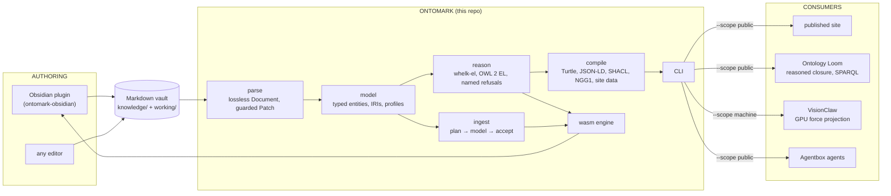

# Ontomark

**Ontologies written as Markdown notes, read and reasoned over by machines.**

You keep writing notes the way you already do. A line or two of YAML frontmatter on a note (`type: class`, `subclass-of: [[Animal]]`) turns it into an ontology statement; everything else stays prose. Ontomark parses those notes without losing a byte, builds a typed model from them, reasons over it with an OWL 2 EL engine, compiles it to RDF and the web, and, when asked, lets a language model propose new facts for a note, grounded against the vocabulary the vault already has, with the quote that justifies each one. It is a Rust workspace, compiles to WebAssembly, and runs the same code inside Obsidian as on a server.

[](https://github.com/DreamLab-AI/ontomark/actions/workflows/ci.yml)
[](NOTICE)

## If you are new here

Ontomark exists because two things usually sold as opposites are both true: people think and write best in free text, and machines are only useful with structure. Most tools pick one. Ontomark keeps the notes as the source of truth and derives the structure from them, so the author never leaves Markdown and the machine never has to guess.

Three ideas carry the whole design:

1. **The note is the record.** Nothing is re-rendered from a typed view. The only write path is a guarded patch that proves every byte it did not name is unchanged. Identity is an IRI the author wrote, never a title the tool slugified.
2. **Refusals are named, never silent.** The engine implements a profile of OWL 2 EL and reports each construct it cannot reason over. A result that dropped an axiom says so, rather than reporting a classification that is quietly incomplete.
3. **Models propose, the vault decides.** Assisted ingest lets a language model read a note and suggest values, but the model never sees an identifier and never writes: the engine grounds each proposed name against the vault, requires a located quote as evidence, and returns candidates for a human to accept.

If you want to see it work before reading more, install the [Obsidian plugin](https://github.com/DreamLab-AI/ontomark-obsidian) and write the two notes below. If you want to use it as a library, start with `ontomark-parse`, then `ontomark-model`; everything else is built on those two. If you are here for the DreamLab estate pipeline, read [ADR-OM-005](docs/adr/ADR-OM-005-estate-alignment-one-producer-explicit-projections.md) first and the CLI section below.

## Start with two notes

`Animal.md`:

```markdown
---
type: class
title: Animal
---
```

`Dog.md`:

```markdown
---
type: class
subclass-of: ["[[Animal]]"]
---
```

Under the generic profile these are two classes, with Dog a subclass of Animal. Prose links stay navigation; only frontmatter makes axioms. In Obsidian, the plugin indexes, classifies and queries the vault locally, and previews every frontmatter edit as a diff before applying it.

## How the pieces fit



Every arrow out of the CLI carries a **generation**: `<prefix>@<commit>` (`visionGraph@<commit>` for the estate; a vault's directory name otherwise) plus a content digest, stamped into each bundle. A consumer can always say which corpus it is reading, and a stale read is refused rather than served. One producer builds every bundle; consumers project from it rather than re-parsing the vault.

| Repository | Role |
| --- | --- |
| **ontomark** (here) | The engine: crates, CLI, wasm build, estate profile. The only producer of published bundles. |
| [ontomark-obsidian](https://github.com/DreamLab-AI/ontomark-obsidian) | The desktop plugin. Embeds the wasm engine; offline by default; one optional network call for assisted ingest. |
| [visionGraph](https://github.com/DreamLab-AI/visionGraph) | The DreamLab corpus itself: ~9,250 typed notes. Its publish pipeline runs the pinned `ontomark` release. |
| [loom](https://github.com/DreamLab-AI/loom) | The Ontology Loom: serves the reasoned closure, SPARQL and grounded answers over a published generation. |
| [VisionClaw](https://github.com/DreamLab-AI/VisionClaw) | The XR/GPU knowledge-graph application. Consumes the machine-scope bundle for its force layout. |
| [agentbox](https://github.com/DreamLab-AI/agentbox) | The agent runtime. Bakes the released CLI and routes the grounding skill through it. |

### Vault layout

A vault is an ordinary Obsidian vault: notes at the vault root, ids are the root-relative path without `.md`, and the furniture folders (`templates/`, `bases/`, `assets/`, `journals/`, `.obsidian/`) are skipped and reported, never silently dropped ([ADR-OM-007](docs/adr/ADR-OM-007-vault-root-is-the-content-root.md)). Where the two vault roles live is the profile's `layout` — `knowledge/` and `working/` beside `ontology/` for the estate, or `"."` when the repository root *is* the vault. Point the CLI at any Obsidian vault and it is a repository: `ontomark --repo ~/Vaults/Notes validate` runs under the generic profile with the built-in vocabulary, builds to `Notes@<sha>`, and refuses `--vault working` with exit 2 because that layout has no working vault ([ADR-OM-008](docs/adr/ADR-OM-008-any-obsidian-vault-is-a-repository.md)). The output tree (`publish/pages/`, `publish/working/`, reports keyed by role) is the same whatever the input layout.

## Command line

Install from crates.io, or take the release binary:

```bash
cargo install ontomark
```

Each [release](https://github.com/DreamLab-AI/ontomark/releases) ships a static Linux x86-64 binary (runs on glibc and Nix hosts alike), a SHA-256 receipt, and the versioned WASM engine bundle the plugin pins.

```bash
V=0.4.0
curl -fLO https://github.com/DreamLab-AI/ontomark/releases/download/v$V/ontomark-x86_64-unknown-linux-gnu
curl -fLO https://github.com/DreamLab-AI/ontomark/releases/download/v$V/ontomark-x86_64-unknown-linux-gnu.sha256
sha256sum --check ontomark-x86_64-unknown-linux-gnu.sha256
chmod +x ontomark-x86_64-unknown-linux-gnu && ./ontomark-x86_64-unknown-linux-gnu --help
```

| Command | What it does |
| --- | --- |
| `validate` | OKF conformance, vocabulary and link integrity for the selected vaults. |
| `gate`, `conflicts` | The autonomous quality gate and the conflict detector, over every selected vault. |
| `build` | The publication build: Turtle (asserted and inferred), JSON-LD, SHACL, OKF, NGG1 graph tiers, search and scaffold indexes, the page API, a redacted `publish/` tree, and the generation marker. |
| `build --scope machine` | A second bundle for machine consumers: the same ontology artefacts byte for byte, plus the public `working/` notes as plain records. Never writes `publish/`. |
| `build --with-rvdb` | Also emits `data/ontology-corpus.records.jsonl`, the portable vector records the Loom promotes into its store. |
| `repair`, `migrate` | Fence and body repairs; registry-driven corpus migrations with plan/apply/rollback. |

Exit codes are a contract: `0` success, `1` failure, `2` a *refusal* (a credential in published content, an identity collision, an unsatisfiable corpus, a non-boolean `public:` flag, an unknown `--tier`, a scope conflict). Refusals name what they refused.

`--repo` names either a plain Obsidian vault (no `ontology/` folder; the generic profile applies) or an estate-shaped repository holding `ontology/vocabulary.yaml`, where the [estate profile](profiles/estate) is the default and `--profile generic|PATH` overrides it. The [CLI README](crates/ontomark-cli/README.md) has the verbs, exit codes and layout in full.

## Rust crates

Each crate has a README and full rustdoc with executable examples. Read them in this order if you are learning the codebase.

| Crate | Version | What it owns |
| --- | --- | --- |
| [ontomark-parse](crates/ontomark-parse) | 0.1.2 | The Markdown format: lossless `Document`, frontmatter and body indexes, the guarded `Patch`. |
| [ontomark-model](crates/ontomark-model) | 0.1.2 | Meaning: typed entities, IRIs as identity, predicate forms, reference resolution, pluggable `Profile`. |
| [whelk-el](crates/whelk-el) | 0.1.1 | The saturation engine, a Rust port of Whelk, with optional native parallelism. |
| [ontomark-reason](crates/ontomark-reason) | 0.1.2 | The OWL 2 EL profile check and classification facade: named refusals, root causes, cancellable sessions. |
| [ontomark-ingest](crates/ontomark-ingest) | 0.1.0 | Assisted ingest: the pure plan/accept contract, grounding, lexical guards, evidence spans. No I/O, no model. |
| [ontomark-compile](crates/ontomark-compile) | 0.4.0 | The publication compiler: emitters, redaction, the two-scope build, vault layout, generation identity. |
| [ontomark-ngg1](crates/ontomark-ngg1) | 0.1.0 | The shared binary graph format and its zero-copy reader. |
| [ontomark-profile-estate](profiles/estate) | 0.4.0 | The DreamLab estate's rules as data; most users want `--profile generic` and never depend on it. |
| [ontomark-wasm](crates/ontomark-wasm) | release asset | The worker-friendly engine protocol: index, update, classify, query, patch, ingest. |
| [ontomark](crates/ontomark-cli) | 0.4.0 | The installable CLI: `cargo install ontomark`. |
| [ontomark-graph](packages/graph) | [0.1.0](https://github.com/DreamLab-AI/ontomark/releases/tag/ontomark-graph-v0.1.0) | The shared offline graph renderer for desktop and web hosts. |

Parser, model, reasoner and ingest build for native and `wasm32-unknown-unknown`. The compiler's portable feature set disables its native backend.

## Structure pays, measured on the estate

Ontomark is the engine under the DreamLab estate's own corpus, so the argument for typed Markdown can be made with numbers rather than principle. Figures are from the corpus and the [Ontology Loom](https://github.com/DreamLab-AI/loom) at generation `visionGraph@ae913f93` (12 October 2026).

| What | Figure | What it shows |
| --- | --- | --- |
| Typed notes in the corpus | 9,258 | Every page is a `type: Class` note with frontmatter relations |
| Asserted `is-a` edges | 13,638 | What authors wrote; 2,378 notes declare more than one parent |
| Subclass statements in the reasoned closure | 118,872 | What follows from it: about nine times what was written, all derivable, none guessed |
| Properties | 15 | A small, stable vocabulary carries a large corpus |
| Grounded answer score (Loom benchmark) | 0.146 → 0.94 and 0.268 → 0.94 | Two models with very different unaided scores converge once given the reasoned slice as a structured scaffold, at three to six times lower latency |

The Loom benchmark is 37 held-out questions with gold answers derived from the graph, so it measures faithful restatement of checked facts, which is the job, not open-domain knowledge. Its lift concentrates in niche domains the models did not already know and vanishes where they were already right; prose renderings of the same facts added nothing measurable. The structure carries the value, which is why the engine's output is a typed model and an RDF closure rather than text.

External figures the READMEs cite, with verification status, are in [`docs/GROUNDING-EVIDENCE.md`](docs/GROUNDING-EVIDENCE.md). The same parser, reasoner and ingest guards run unchanged in the plugin, which is deliberately light on this material: it exists for vaults of ten notes as much as ten thousand.

## Build and check

Rust 1.89 or later is required by the locked workspace. Install `wasm32-unknown-unknown` to build the browser engine; `x86_64-unknown-linux-musl` to build the release binary. The plugin repository builds with Node against a checksum-pinned engine release, independently of this workspace.

```bash
cargo build --locked --workspace
cargo test --locked --workspace
cargo clippy --locked --workspace --all-targets -- -D warnings
RUSTDOCFLAGS='-D warnings' cargo doc --locked --workspace --no-deps
cargo build --locked -p ontomark-wasm --target wasm32-unknown-unknown --release
cargo build --locked -p ontomark-ingest --target wasm32-unknown-unknown --release
```

`just check`, `just wasm-test` and `just conformance` are the repository gates. CI checks formatting, Clippy, native tests, compiler all/no-default-feature tests, WASM, strict rustdoc, plugin contracts and the complete Git history for secrets. The plugin tests include WASM/native transcript parity and an offline Obsidian API shim; that shim does not substitute for installed-Obsidian acceptance.

## Current limits

This is experimental software. The reasoner implements a subset of OWL 2 EL and reports unsupported constructs explicitly; dropped existential restrictions make a classification incomplete ([ADR-OM-004](docs/adr/ADR-OM-004-owl2-el-as-the-local-reasoning-profile.md) records why EL, and how non-EL is named rather than dropped). The native publication compiler retains its legacy estate profile semantics while using the shared reasoner; typed in-memory projection is available through the compiler's `model-projection` feature.

Turtle, JSON-LD, SHACL, SKOS, PROV-O and Dublin Core form the publication surface. Public projections omit private content and sanitise links to private targets. Conformance and privacy tests record the supported behaviour; no claim of complete OWL 2 EL or universal standards conformance is made. The NGG1 graph format collapses named relations to one edge type; per-relation edges need a format bump.

## Project documentation

- [Current hand-off](docs/HANDOFF.md): verified results, outstanding work and integration boundaries.
- [API documentation](docs/api/): crate contracts and capabilities.
- Decisions: [ADR-OM-001](docs/adr/ADR-OM-001-sprint-decisions.md) (profiles, licensing, reasoner), [ADR-OM-002](docs/adr/ADR-OM-002-shared-graph-and-obsidian-boundary.md) (shared graph and plugin boundary), [ADR-OM-003](docs/adr/ADR-OM-003-native-assisted-ingest.md) (assisted ingest), [ADR-OM-004](docs/adr/ADR-OM-004-owl2-el-as-the-local-reasoning-profile.md) (OWL 2 EL), [ADR-OM-005](docs/adr/ADR-OM-005-estate-alignment-one-producer-explicit-projections.md) (one producer, the generation loop), [ADR-OM-006](docs/adr/ADR-OM-006-dot-triples-interop.md) (Dot Triples interop), [ADR-OM-007](docs/adr/ADR-OM-007-vault-root-is-the-content-root.md) (flat vaults, the vault verbs), [ADR-OM-008](docs/adr/ADR-OM-008-any-obsidian-vault-is-a-repository.md) (any Obsidian vault is a repository; layout and generation prefix from the profile), and the [estate ADR index](docs/adr/ESTATE-ADRS.md).
- [OntoCast triage](docs/ONTOCAST-TRIAGE.md): what the ingest design adapted from OntoCast and what it did not.
- [Dot Triples bridge](bridges/dot-triples/README.md): one SPARQL CONSTRUCT that lifts Cristian Vasquez's [dot-triples](https://github.com/cristianvasquez/dot-triples) output into Ontomark's vocabulary, tested for parity with the engine.
- [Upstream projects](docs/UPSTREAMS.md) and [third-party notices](THIRD-PARTY-NOTICES.md).
- [Estate migration plan](docs/DEPRECATION.md) and [branch recovery](docs/BRANCH-RECOVERY.md).
- [Run log](docs/RUNLOG.md) and [evidence](docs/evidence/resume/).
- [Nightly dreaming](docs/dream-cycle/README.md): native contract evaluation in the estate's nightly cycle.
- The architecture is drawn, citation by citation, in the VisionFlow diagrams corpus under `docs/diagrams/ontomark/`.

Maintained by [John O'Hare](https://github.com/jjohare) and [DreamLab AI](https://github.com/DreamLab-AI).

## Licence

MIT OR Apache-2.0. [NOTICE](NOTICE) records the rights holder's relicensing grant and exclusions. The reasoner preserves the Rust port's MIT notice and Scala Whelk's BSD-3-Clause notice; see [its README](crates/whelk-el/README.md).
